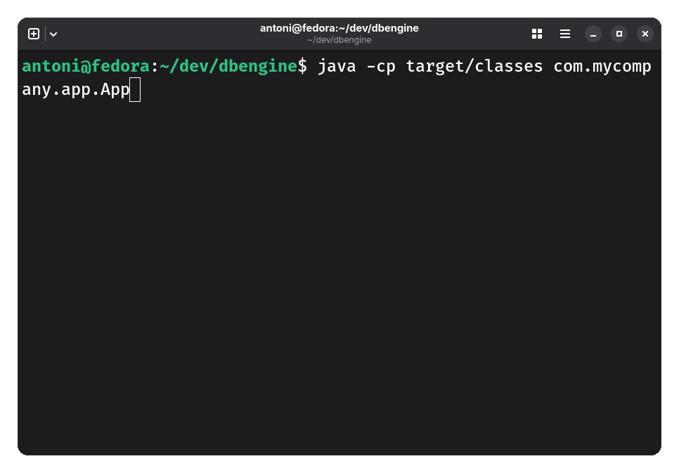

# Database Engine

A sqlite like local database engine that works on a *limited* subset of SQL. Create, Insert, Delete are mostly functional. Alter and Update not yet.

Using a recursive descent parser for creating an AST from entered code. 

Databases and tables are stored as simply as possible as objects made up of maps which can be written/read to disk via the serializable interface.

Automated testing performed using GitHub Actions on every commit using `JUnit` and builds using `Maven`.

# Example Usage of CLI and functionality demonstration
Example of using the cli interface for some basic database tasks:

- Create a database
- Create two tables, users and orders
- The two tables are linked via a foreign key
- Inserting into orders only works when there exists a user which fits the constraint;
- Deleting from users will also delete orders as per the ON DELETE declaration.



# Running Locally
Pre-req:
- Java 21+
- Maven 

Clone
```
git clone git@github.com:antonizyla/dbengine.git
cd dbengine/
```
Build
```
mvn clean package
```
Run tests
```
mvn verify
```
Run CLI shell
```
java -cp target/classes com.mycompany.app.App
```